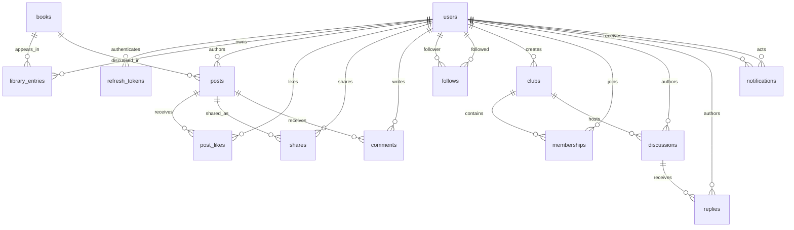

# PostgreSQL schema overview

Flyway applies `V1__initial_schema.sql` and subsequent immutable versioned migrations. Every table has a UUID primary key and `created_at` / `updated_at` timestamps. UUIDs and normal audit timestamps are assigned by JPA; bulk notification updates explicitly update their audit timestamp.

Foreign keys have indexes and cascade when their parent is removed. Composite unique constraints enforce one library entry per reader/book, one like per reader/post, one directed follow per pair, one membership per reader/club, and unique refresh-token hashes. Users cannot follow themselves. Email is normalized lowercase and unique. Role and reading-status checks constrain their allowed values; progress is 0–100. The partial `only_one_admin` index allows at most one admin; startup creates the required account, making the application operational only after an admin exists. Admin blocking is forbidden by both service and database rules.

Additional indexes cover unread notifications, refresh expiry, catalogue title/author, post chronology, and per-club/per-discussion chronology. Substring catalogue searches may need PostgreSQL trigram indexes at larger scale; no extension privileges are required by this schema.

Genres are canonical lowercase labels stored as a pipe-delimited set in `books.genres` and `users.favourite_genres`. API validation excludes the separator. This intentionally avoids per-book association loads; the recommendation query splits labels inside PostgreSQL. A normalized genre table or materialized affinity data can replace this representation if catalogue scale warrants it.

Notification resources are polymorphic UUID references, so `resource_id` has no single foreign key. Historical notifications can reference deleted resources. Refresh tokens store a SHA-256 digest, never plaintext; users store BCrypt hashes and a token version for revocation. No password or token field appears in public DTOs.
